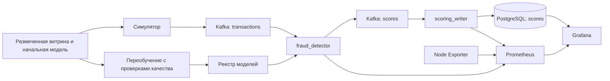

# HW5: мониторинг потокового антифрода

Проект добавляет Prometheus, Grafana, Node Exporter и бизнес-анализ к нашему решению HW3: транзакции проходят через Kafka, получают скор действующей модели и сохраняются в PostgreSQL. Модель обучается и выполняет инференс на CPU. GPU не нужен.

По умолчанию запускается самостоятельная демонстрация с синтетическими размеченными данными и непрерывным потоком примерно 10 транзакций в секунду. Внешний CSV и Airflow для этой демонстрации не требуются. Синтетические данные предназначены для проверки обработки, мониторинга и переобучения; качество на них не является оценкой качества антифрода на реальных платежах.

[Результаты проверки на удалённой WSL](reports/RESULTS.md): 151 тест, 56 запросов дашбордов, срабатывание и восстановление двух алертов, публикация модели без перезапуска скорера и выполнение трёх DAG Airflow.

В качестве учебного ориентира использован [репозиторий семинара 11](https://github.com/NikitaMalykhin/mlops_realtime_fraud_detector_monitoring). Код приложения продолжает нашу HW3, а конфигурация Prometheus, четыре дашборда, SQL-запросы и правила оповещения написаны для этого проекта. JSON дашбордов семинара не копировались.

## Запуск

Нужны Docker Engine с Docker Compose v2 и Linux-контейнеры. В Windows команды Docker удобно выполнять в WSL2. Node Exporter читает Linux `/proc`, `/sys` и корневую файловую систему хоста Docker; при запуске через WSL графики относятся к Linux-среде WSL, а не ко всей Windows-машине.

Все команды ниже выполняются из корня проекта (локально это каталог `hw5`):

```bash
cp .env.example .env
docker compose up --build -d --wait --wait-timeout 300
docker compose ps
```

В PowerShell вместо первой команды можно использовать `Copy-Item .env.example .env`. Если установлен GNU Make, запуск сокращается до `make up`. Первый запуск скачивает образы, создаёт размеченную витрину и обучает начальную модель. После этого симулятор автоматически начинает отправлять транзакции. Для заполнения графиков `rate` и первых 30-секундных окон дайте потоку поработать около минуты.

| Сервис | Адрес | Доступ по умолчанию |
| --- | --- | --- |
| Grafana | [http://localhost:3000](http://localhost:3000) | `admin` / `admin` |
| Prometheus | [http://localhost:9090](http://localhost:9090) | Без отдельной авторизации, порт привязан к localhost |
| Airflow, дополнительный профиль | [http://localhost:8085](http://localhost:8085) | `admin` / `admin` |
| Артефакты и отчёты, дополнительный профиль | [http://localhost:8086](http://localhost:8086) | Просмотр файлов общего хранилища |

Порты и пароли задаются в `.env`. При первом входе Grafana может предложить сменить пароль. Если приложение работает на удалённой машине, эти адреса доступны через SSH-перенаправление соответствующих портов. Привязка портов в Compose — `127.0.0.1`.

Пароли PostgreSQL и первоначальный пароль администратора Grafana применяются при инициализации новых томов. Изменение `.env` не меняет пароль уже существующего пользователя в БД или Grafana; его нужно отдельно обновить в соответствующем сервисе, сохранив данные. Специальные символы пароля PostgreSQL корректно кодируются для соединения Airflow.

Полезные команды:

```bash
docker compose logs -f --tail=100 fraud_detector scoring_writer simulator
docker compose stop simulator
docker compose start simulator
docker compose --profile airflow down
```

Последняя команда останавливает проект, сохраняя данные в именованных томах. Повторный запуск использует существующие модели, таблицы, историю метрик и Grafana. Не добавляйте `-v`, если эти данные нужно сохранить.

Если в WSL не заполняется сетевой график, проверьте `docker compose logs node-exporter` и наличие `node_network_receive_bytes_total` в Prometheus. Штатный `node-exporter/entrypoint.sh` подготавливает `/tmp/proc-view`, чтобы сетевые счётчики читались из пространства хоста WSL, а не самого контейнера. Этот entrypoint и параметры сетевых collectors в Compose нужны вместе. Корень хоста монтируется только для чтения без требования `rslave`, которое не поддерживается некоторыми конфигурациями монтирования WSL.

## Что запускается



Скорер публикует результат только после успешного вычисления и подтверждения Kafka. Writer записывает результат в PostgreSQL, а затем подтверждает сообщение Kafka. Первичный ключ `transaction_id` обеспечивает идемпотентность: повторная доставка не создаёт вторую строку и не увеличивает счётчики новых записей. Некорректные сообщения попадают в `dead_letters`.

Prometheus опрашивает `fraud_detector:8000`, `scoring_writer:8001` и `node-exporter:9100` раз в секунду. Эти порты доступны внутри сети Compose. Prometheus хранит историю до семи дней с ограничением размера 1 ГБ. Grafana обновляет дашборды каждые пять секунд.

Конфигурация находится в `prometheus/prometheus.yml`; источники данных, дашборды и алерты загружаются из `grafana/provisioning/`. Источник PostgreSQL использует отдельного пользователя `grafana_reader` с правом чтения таблицы результатов. Идентификаторы источников: `prometheus` и `postgres`.

## Дашборды

Они находятся в папке **HW5 Fraud Monitoring**. Вверху каждого есть переходы к остальным дашбордам с сохранением выбранного времени.

| Дашборд | Ссылка | Содержание |
| --- | --- | --- |
| **HW5 / Scoring pulse** | [Открыть](http://localhost:3000/d/hw5-scoring) | TPS скорера, p50/p95/p99 времени обработки, доля и количество флагов, тепловая карта скоров, активации и ошибки обновления модели, точные SQL-счётчики и доля флагов по версиям |
| **HW5 / Durable writes** | [Открыть](http://localhost:3000/d/hw5-writer) | TPS успешных вставок, p95 записи и доставки от producer до commit, доля и число записанных флагов, распределение скоров, повторные доставки, последние строки БД |
| **HW5 / Compute health** | [Открыть](http://localhost:3000/d/hw5-system) | CPU, используемая RAM, сеть, заполнение файловых систем, дисковое чтение/запись, load average и доступность scrape targets |
| **HW5 / Fraud investigation** | [Открыть](http://localhost:3000/d/hw5-business) | Фильтры штата и торговца, плотность скоров, TPS по времени обработки, доля флагов по категориям, денежный объём помеченных операций и таблицы детализации |

SQL-панели на экране скоринга используют тот же интервал времени обработки, что и бизнес-анализ. Поэтому можно сопоставить распределение нагрузки между версиями модели и их доли флагов. Флаг модели не равен подтверждённому мошенничеству, а сумма помеченных операций не равна фактическому убытку.

Графики со скоростью показывают среднее за окно, а не величину накопительного счётчика. `rate` и `increase` учитывают сброс счётчика при перезапуске процесса; из-за экстраполяции значения `increase` могут быть дробными. SQL-панели показывают точное число сохранённых строк.

Исходник дашбордов — `grafana/build_dashboards.py`. После изменения запросов выполните:

```bash
python grafana/build_dashboards.py
```

JSON в `grafana/dashboards/` уже готов для запуска; Python на хосте нужен только для его регенерации. Файлы provisioning являются источником конфигурации, поэтому изменения через интерфейс Grafana не сохраняются как правки проекта.

## Метрики приложения

Объявления и моменты обновления метрик находятся в `common/metrics.py`. У гистограмм Prometheus автоматически создаёт ряды `_bucket`, `_sum` и `_count`.

| Метрика | Тип | Когда обновляется и зачем нужна |
| --- | --- | --- |
| `fw_transactions_total` | Counter | Успешно рассчитанный результат подтверждён Kafka; основа TPS скорера |
| `fw_processing_seconds` | Histogram | Длительность успешной валидации, инференса и публикации; основа квантилей задержки |
| `fw_score` | Histogram | Распределение опубликованных вероятностей в диапазоне 0–1 |
| `fw_fraud_total` | Counter | Число опубликованных решений с `fraud_flag=1` |
| `fw_model_activations_total{version}` | Counter | Успешная загрузка версии в память скорера |
| `fw_model_activated_timestamp_seconds{version}` | Gauge | Фактический момент последней активации версии; источник аннотаций |
| `fw_scores_written_total` | Counter | Новая строка успешно закоммичена в PostgreSQL |
| `fw_write_seconds` | Histogram | Время успешной новой вставки вместе с commit |
| `fw_written_score` | Histogram | Скоры только новых сохранённых строк |
| `fw_written_fraud_total` | Counter | Флаги только новых сохранённых строк |
| `fw_write_duplicates_total` | Counter | Повторные доставки, пропущенные по первичному ключу |
| `fw_end_to_end_seconds` | Histogram | Время от живого `emitted_at` до commit новой строки; показывает задержку всей цепочки |
| `fw_last_transaction_timestamp_seconds` | Gauge | Момент последнего успешного события каждого сервиса; различается по scrape label `job` |
| `fw_rejected_total{service}` | Counter | Некорректные сообщения, подтверждённые после отправки в DLQ; `service` равен `scorer` или `writer` |
| `fw_model_reload_failures_total` | Counter | Ошибки попыток обновить модель |
| `fw_model_reload_failed` | Gauge | Результат последней попытки обновления: 1 при ошибке, 0 при успехе |

Собственная дополнительная метрика **скорера** — `fw_model_reload_failures_total`. Она показывает неудачные попытки обновления модели, которые могут быть незаметны по TPS: скорер продолжает работать на последней валидной версии. На **Scoring pulse**, панель **Model reload failures · rolling 1m** (ID 14), построен график `sum(increase(fw_model_reload_failures_total[1m]))`; рядом **Model reload health** (ID 13) показывает последнее состояние `fw_model_reload_failed` как **Healthy** или **Reload failed**. При повреждённом артефакте попытка может повторяться перед каждой транзакцией, поэтому счётчик измеряет попытки, а не число уникальных проблемных версий.

Дополнительная метрика writer — `fw_write_duplicates_total`: она отделяет восстановление после повторной доставки от полезной записи. Это помогает объяснить, почему Kafka-сообщений обработано больше, чем появилось строк в БД. Ещё одна добавленная метрика, `fw_end_to_end_seconds`, показывает задержку всей доставки, которую нельзя определить только по времени SQL-вставки. [Исходный writer семинара](https://github.com/NikitaMalykhin/mlops_realtime_fraud_detector_monitoring/blob/main/scoring_writer/app.py) использован для сопоставления обязательного набора метрик.

Состояния, торговцы, категории и идентификаторы транзакций не становятся labels Prometheus. Они хранятся в PostgreSQL и фильтруются SQL-запросами; так число временных рядов не растёт с числом транзакций и торговцев. Версия модели используется в labels только для редких событий активации.

Примеры запросов для Prometheus:

```promql
sum(rate(fw_transactions_total[30s]))

histogram_quantile(0.95, sum by (le) (rate(fw_processing_seconds_bucket[30s])))

sum(rate(fw_fraud_total[30s])) / clamp_min(sum(rate(fw_transactions_total[30s])), 1e-9)

sum(rate(fw_scores_written_total[30s]))

sum(increase(fw_write_duplicates_total[5m]))
```

## Фильтры и бизнес-анализ

На **Fraud investigation** переменные `us_state` и `merch` отображаются как **State** и **Merchant**. Можно выбрать один или несколько вариантов. Вариант **All** имеет значение `__all`; если он выбран вместе с другими значениями, фильтр этой переменной отключён. Чтобы ограничить выборку, снимите **All**. Значения подставляются через `${us_state:sqlstring}` и `${merch:sqlstring}`, включая корректное экранирование апострофов. После появления новых значений список можно обновить перезагрузкой дашборда.

Основные определения:

1. **Плотность скоров**: 20 интервалов шириной 0,05. Высота столбца равна `число в интервале / (размер отфильтрованной выборки × 0,05)`. Сумма площадей равна единице; высота может быть больше единицы. Скор 1 входит в последний интервал. Для пустой выборки плотность не определена.
2. **Processing TPS**: число сохранённых результатов с `processed_at` внутри временного интервала, делённое на его длительность. Пустые интервалы заполнены нулями; крайние неполные интервалы делятся на фактическое число секунд внутри выбранного диапазона.
3. **Fraud fraction by category · latest 1,000 overall**: сначала выбираются глобально последние 1 000 записанных транзакций по `sequence DESC`, затем применяются фильтры штата и торговца, затем для каждого `cat_id` считается `число флагов / число транзакций категории`. Этот график и соседняя таблица размеров выборки намеренно не используют переключатель времени. При количестве строк меньше 1 000 берутся все доступные.
4. **Flagged amount by state** и **Merchant exposure**: сумма `amount` для записей с флагом в выбранном интервале и фильтрах. Эти представления помогают оценить денежный объём операций, требующих проверки, а не только их число.

Времена в таблице `scores` имеют разные значения:

| Поле | Значение |
| --- | --- |
| `transaction_time` | Время исходного события; демонстрационный симулятор задаёт текущее время, внешние события могут содержать историческое |
| `emitted_at` | UTC-время отправки живым producer; используется для сквозной задержки |
| `processed_at` | UTC-время формирования результата скорером; используется для бизнес-TPS и диапазона бизнес-панелей |
| `scored_at` | Время вставки в PostgreSQL; используется на SQL-панелях writer |
| `sequence` | Монотонный порядок вставок; определяет окно последних 1 000 транзакций |

Сырые результаты можно посмотреть отдельно:

```bash
docker compose exec postgres psql -U airflow -d airflow -c "SELECT transaction_id, score, fraud_flag, model_version, us_state, merch, cat_id, amount, processed_at, scored_at FROM scores ORDER BY sequence DESC LIMIT 10;"
```

## Переобучение и отметки смены модели

Для ручного запуска той же цепочки, которую использует Airflow:

```bash
make retrain
# Без GNU Make:
docker compose --profile tools run --rm --no-deps tools python scripts/retrain.py --advance-month
```

`--advance-month` сначала добавляет следующий размеченный месяц. В стандартной синтетической демонстрации это новый воспроизводимый батч; размер задаётся `MONTHLY_BATCH_SIZE` (по умолчанию 3 000). История ограничена `HISTORY_MONTHS` (по умолчанию 36).

Сохраняются проверки и правила публикации HW3:

- Трёхмесячное окно непрерывно по календарю: два более ранних месяца идут в обучение, последний — в проверку кандидата. Преобразования признаков и модель сохраняются одним sklearn Pipeline и используются одинаково при обучении и инференсе.
- Перед обучением проверяются схема, обязательные значения, уникальность идентификаторов, диапазоны чисел, координаты, наличие обоих классов, достаточный размер каждого месяца и разделение по времени.
- Кандидат и действующая модель оцениваются на одних и тех же строках последнего месяца по PR-AUC (`average_precision_score`) и ROC-AUC. Публикация разрешена только без регрессии по обеим метрикам с численной погрешностью. Это окно отбора модели, а не независимый финальный тестовый набор.
- Снимок данных, исходная модель и контрольные суммы закрепляются за запуском. Публикация сохраняет неизменяемый артефакт и атомарно обновляет указатель. Отклонённый или устаревший запуск не сдвигает действующую версию.
- Скорер проверяет указатель перед следующей транзакцией и загружает новую валидную модель без рестарта. При ошибке обновления остаётся последняя успешно загруженная модель; ошибка видна в метриках и логах.

Успешная публикация возвращает `published: true`. Если кандидат отклонён, отсутствие отметки новой модели ожидаемо: дашборд отражает фактическую активацию, а не сам факт запуска обучения.

На **Scoring pulse**, **Durable writes** и **Fraud investigation** включена фиолетовая аннотация **Model activations**. Её запрос:

```promql
(fw_model_activated_timestamp_seconds > (time() - 30)) * 1000
```

Временное окно 30 секунд позволяет увидеть событие при scrape раз в секунду и шаге аннотации 10 секунд. `useValueForTime` использует значение метрики в миллисекундах, поэтому отметка ставится в фактический момент загрузки и подписывается `Model <version> activated`. После успешного `make retrain` оставьте симулятор включённым, выберите последние 15 минут и проверьте новую отметку, версию в таблице SQL и сообщение `Activated model version=...` в логах скорера.

Дополнительный профиль Airflow запускается так:

```bash
docker compose --profile airflow up -d --wait --wait-timeout 300
```

В нём доступны DAG `advance_month` (поставка месяца каждые 10 минут), `retrain_model` (переобучение каждые 5 минут) и `data_quality` (отчёт и проверка каждые 5 минут). Их также можно запустить через **Trigger DAG**. Модели и решения доступны в общем хранилище; при включённом профиле их можно просмотреть через сервис артефактов. Файлы решений находятся в `reports/decisions/`, отчёты качества — в `dq_reports/`, текущая модель — в `models/current.json` внутри этого хранилища.

## Алерты и проверка их срабатывания

Два Grafana-managed правила автоматически загружаются из `grafana/provisioning/alerting/rules.yml`. Откройте **Alerting → Alert rules → HW5 Fraud Monitoring**. Проверка правил выполняется каждые десять секунд. В `notifications.yml` круглосуточный интервал `hw5-ui-only` отключает доставку уведомлений, включая стандартный email receiver; SMTP для демонстрации не нужен. [Mute timing](https://grafana.com/docs/grafana/latest/alerting/configure-notifications/mute-timings/) сохраняет вычисление правил и их состояния в Grafana: **Pending**, **Alerting** и возврат в **Normal** остаются видимыми.

| Правило | UID | Условие |
| --- | --- | --- |
| **HW5 - High fraud ratio** | `hw5-high-fraud-ratio` | Доля флагов за 30 секунд больше 20%, при оценке не менее 20 транзакций за то же окно; условие удерживается 30 секунд |
| **HW5 - Scoring stream stalled** | `hw5-stream-stalled` | Последний успешный скор старше 60 секунд, условие удерживается 30 секунд; недоступность scorer target также считается проблемой |

Первый порог превышает обычную долю положительного класса синтетического потока (около 12,5%) и имеет защиту от единичных событий. Второй проверяет продвижение потока, а не только HTTP-доступность экспортера. При намеренно остановленной демонстрации он закономерно срабатывает.

Автоматический сценарий проверки:

```bash
bash scripts/verify_alerts.sh
```

Для ручной демонстрации высокого fraud ratio остановите обычный поток и отправьте около 90 секунд операций из положительного класса размеченной витрины:

```bash
docker compose stop simulator
docker compose --profile tools run --rm --no-deps tools python scripts/simulate.py --mode fraud --rate 10 --count 900
docker compose start simulator
```

Во время отправки наблюдайте переход правила из **Normal** в **Pending**, затем в **Alerting**. После восстановления обычного потока окно очистится и правило должно вернуться в **Normal**. Режим `fraud` выбирает признаки из положительного класса, но не передаёт метку в Kafka и не подменяет результат модели: окончательный флаг вычисляет действующая модель. На другом обучающем наборе фактическая доля флагов может отличаться; смотрите значение правила.

Для демонстрации остановки потока:

```bash
docker compose stop simulator
# Подождите примерно 100 секунд и проверьте Alerting в Grafana.
docker compose start simulator
```

Отсчёт идёт от последней действительно обработанной транзакции; если Kafka ещё содержит очередь, сначала дождитесь её обработки. После возобновления обработки правило возвращается в **Normal**. Простое открытие `/metrics` не восстанавливает его состояние.

## Проверки и воспроизводимость

```bash
# Тесты контрактов, метрик, записи, данных и обучения:
docker compose --profile test run --rm --no-deps tests

# Проверка мониторинга, запросов и нового переобучения:
docker compose --profile tools run --rm --no-deps tools python scripts/verify_monitoring.py

# Повторная проверка без нового переобучения:
docker compose --profile tools run --rm --no-deps tools python scripts/verify_monitoring.py --skip-retrain

# То же через Make:
make test
make verify
```

`verify_monitoring.py` предназначен для запуска после заполнения потока. Он проверяет доступность источников и метрик, provisioning дашбордов, выполнение их PromQL/SQL-запросов и бизнес-представлений. По умолчанию он также добавляет месяц, запускает переобучение с проверками качества и проверяет, что новая версия действительно активирована и попала в PostgreSQL. Для повторной проверки без этого изменения используется `--skip-retrain`.

Полный сценарий `bash scripts/verify.sh` поднимает стенд, запускает тесты, проверяет мониторинг и алерты, сравнивает контейнер скорера до и после обновления модели и собирает отчёты в `reports/`. Отдельный `verify_monitoring.py` сохраняет JSON в `evidence/monitoring.json` общего хранилища. Фактический статус проверок определяется выводом сценария и сохранённым JSON; наличие конфигурационных файлов само по себе не подтверждает работающий стенд. Сценарий проверки алертов временно меняет входной поток и восстанавливает обычный симулятор при выходе.

Для визуальной проверки откройте четыре дашборда, измените фильтры State/Merchant, убедитесь в наличии данных и проверьте подпись активации после успешного переобучения. В Prometheus на странице **Status → Target health** должны быть доступны `fraud-detector`, `scoring-writer` и `node-exporter`.

Основные параметры `.env`:

| Параметр | По умолчанию | Назначение |
| --- | --- | --- |
| `SIMULATOR_RATE` | `10` | Желаемая частота отправки, событий/с; медленный broker может уменьшить фактическую скорость |
| `SIMULATOR_MODE` | `normal` | Обычный поток либо `fraud` для демонстрации |
| `FRAUD_THRESHOLD` | `0.5` | Флаг устанавливается при `score > threshold` |
| `MONTHLY_BATCH_SIZE` | `3000` | Размер следующего размеченного месяца |
| `HISTORY_MONTHS` | `36` | Глубина хранения размеченной истории |
| `TRAINING_CSV` | Пусто | При первом создании витрины используется синтетика; `/data/train.csv` включает импорт размеченного CSV |
| `DATA_DIR` | `./data` | Каталог хоста, который монтируется в контейнер как `/data` |

Для собственного размеченного CSV задайте `DATA_DIR` и `TRAINING_CSV=/data/train.csv` **перед первым запуском нового проекта**. Требуются поля из `pipeline/data.py`: время, `target` и контекст транзакции. Уже созданная витрина не перезаписывается при смене этих переменных. Для импортированных данных должны выполняться проверки трёхмесячного окна. После изменения параметров сервисов используйте `docker compose up -d`, чтобы Compose применил окружение заново.

## Состав решения

| Каталог или файл | Назначение |
| --- | --- |
| `common/` | Контракты событий, Kafka и метрики |
| `fraud_detector/` | Онлайн-скоринг и загрузка модели |
| `scoring_writer/` | Идемпотентная запись результата и контекста |
| `database/` | Схема `scores` и отдельный пользователь Grafana |
| `pipeline/`, `dags/` | Размеченная витрина, проверки данных, обучение и публикация |
| `prometheus/` | Конфигурация сбора метрик |
| `node-exporter/` | Чтение сетевых метрик хоста при работе Docker в WSL |
| `grafana/` | Четыре оригинальных дашборда, источники и правила оповещения |
| `scripts/` | Симулятор, ручное переобучение и проверочные сценарии |
| `tests/` | Автоматические проверки приложения |
| `docker-compose.yml`, `Makefile`, `.env.example` | Воспроизводимый запуск |
