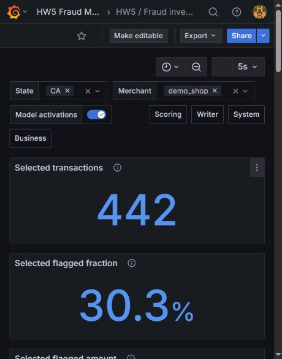
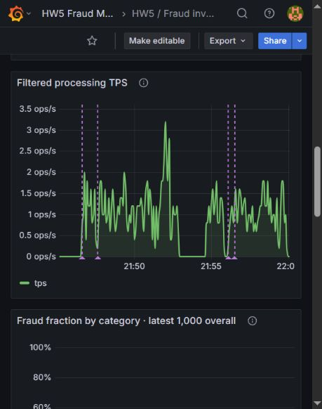
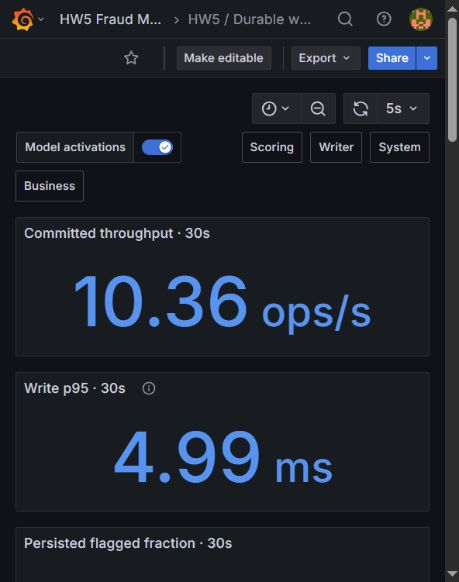
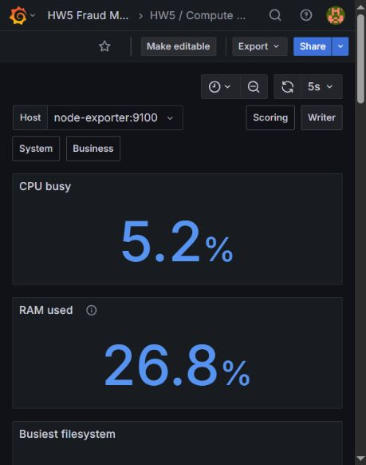

# Проверка HW5 на удалённой WSL

Проверка выполнена 23 октября 2026 года на удалённой Ubuntu/WSL с Docker. Все перечисленные результаты получены от работающего потока Kafka, модели, PostgreSQL, Prometheus и Grafana. Сервисы HW5 используют отдельный проект Compose `fraud-monitoring-hw5`; другие проекты не изменялись.

| Проверка | Результат | Доказательство |
| --- | --- | --- |
| Тесты приложения и DAG | 151 passed | [tests.txt](tests.txt) |
| Все запросы четырёх дашбордов | 56 запросов выполнены через Grafana без ошибок, данные присутствуют | [monitoring.json](monitoring.json) |
| Живой поток | Счётчики скоринга и сохранённых результатов растут | `live_counters` в monitoring.json |
| Публикация и загрузка модели | `202405-d3989bb8b5dc` → `202406-2f59995e3f61`; новая версия в PostgreSQL и annotation-запросе | `retraining`, `activation_annotation` в monitoring.json |
| Отсутствие рестарта при публикации | ID, StartedAt и RestartCount скорера до/после совпадают | [scorer-before.txt](scorer-before.txt), [scorer-after.txt](scorer-after.txt) |
| Фильтры State/Merchant | All, штат, торговец и их пересечение проверены на одном снимке данных | `business.filters` в monitoring.json |
| Плотность скоров | Интеграл равен 1 для каждой непустой выборки | `density_area` в monitoring.json |
| TPS | Интеграл скорости по времени равен числу выбранных транзакций | `tps_integrated_count` в monitoring.json |
| Последние 1 000 строк | Числители, знаменатели и доли по категориям совпадают с независимым SQL через row_number | `business.filters[].categories` в monitoring.json |
| PostgreSQL datasource | Пользователь grafana_reader; read-only; INSERT запрещён | `business.database_role` в monitoring.json |
| Алерт высокой доли фрода | Firing на реальном fraud-потоке, затем Normal на обычном | [firing](alert-hw5---high-fraud-ratio-firing.json), [normal](alert-hw5---high-fraud-ratio-inactive.json) |
| Алерт остановки потока | Firing после остановки симулятора, затем Normal после запуска | [firing](alert-hw5---scoring-stream-stalled-firing.json), [normal](alert-hw5---scoring-stream-stalled-inactive.json) |
| Системные метрики | Сеть, CPU, память и размер корневой ФС сверены с хостом WSL; 7 проверок прошли | [host-metrics.json](host-metrics.json) |
| Дополнительный профиль Airflow | advance_month, data_quality, retrain_model выполнены; новая модель `202408-04ff0cb5abd0` обслужила поток | [airflow-e2e.txt](airflow-e2e.txt), [latest.json](latest.json) |
| Отсутствие рестарта при Airflow-публикации | Метаданные контейнера совпадают до/после DAG | [before](airflow-scorer-before.txt), [after](airflow-scorer-after.txt) |

Тесты работали с синтетическими данными по умолчанию. Эти результаты подтверждают функционирование системы и проверок, а не качество модели на реальных платежах. Данные в графиках меняются во времени; сохранённые отчёты описывают конкретные снимки.

Версии среды: [Docker](docker-version.txt), [Compose](compose-version.txt). Для быстрой сборки на существующем сервере использован `--build-arg BASE_IMAGE=fraud-airflow-hw3:local` с уже установленными закреплёнными зависимостями; `pip check` выполнялся при сборке. Обычный Dockerfile по умолчанию использует `apache/airflow:2.10.5-python3.11`. Чистая сборка в GitHub Actions ещё не выполнялась.

После проверки дополнительный Airflow-профиль остановлен; основной непрерывный поток и мониторинг оставлены работающими. [Состояние сервисов](compose-status.txt). Данные и журналы проверок сохранены. Повторить основные проверки: `bash scripts/verify.sh`; полный сценарий Airflow: `bash scripts/demo.sh`.

Исходники и отчёты доступны в публичном репозитории [ainazarov/fraud-monitoring-hw5](https://github.com/ainazarov/fraud-monitoring-hw5). Проверенная копия проекта также сохранена на удалённой WSL.

## Визуальная проверка

В браузере проверены четыре дашборда, изменение фильтров CA/demo_shop и появление отметок версии модели. API-проверки выше охватывают все панели, включая расположенные ниже первого экрана.

